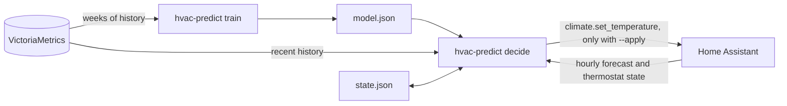

# hvac-predict

`hvac-predict` chooses the heating and cooling setpoints of a Home Assistant thermostat that stays in auto mode. It looks at the weather forecast and decides which of the two setpoints should be the temperature you want, so that the right equipment holds it, and so that nothing runs when the house is about to get there by itself.

A thermostat in auto mode has a heating setpoint and a cooling setpoint a few degrees apart. If you want 68 °F and set it to heat at 68 and cool at 71, a warm afternoon leaves the house at 71. Set it to heat at 65 and cool at 68, and a cold night leaves it at 65. This tool predicts the indoor temperature for the next eight hours and picks between those two pairs. When the thermostat's schedule moves to a new temperature, it gives the house a fixed time to drift there before it lets the equipment take over.

The prediction comes from a small thermal model of your house, fitted to the history you already keep in VictoriaMetrics.

The aim is comfort you don't have to think about: the house at the temperature you asked for, without swapping the thermostat's comfort settings between a summer set and a winter set. It is not an energy saver.

Both setpoints stay live whichever pair is chosen. If the tool stops, or gets it wrong, the thermostat still keeps the house within the gap between them. The one wider gap, and its limit, are under [What can go wrong](#what-can-go-wrong).

> [!WARNING]
> Nothing here has run against a real house, a real Home Assistant or a real VictoriaMetrics. The tests use simulated houses and stand-ins for both servers, so the example queries and the Home Assistant calls are as untried as the model. It was written for an ecobee, from the source of Home Assistant's ecobee integration, and has not met one. In simulation it has not saved energy. Start with dry runs, and read [What can go wrong](#what-can-go-wrong) before you pass `--apply`.

## How it works

The diagram shows what each command reads and writes.



`train` reads weeks of history and fits the model. It learns how quickly the house follows the outdoor temperature, what sunlight, wind and rain add to that, what the furnace and air conditioner do, and how long the walls hold on to heat.

`decide` reads the recent history, the hourly forecast and the thermostat. It predicts the house with the equipment off and chooses a pair of setpoints. It only reports unless you pass `--apply`.

Both commands run once and exit, so a scheduler runs them. Between runs the tool keeps the model, and a small state file that records when the target last changed and which setpoints the tool last sent.

## What you need

- Python 3.12 or newer, and [uv](https://docs.astral.sh/uv/).
- VictoriaMetrics, holding at least three or four weeks of indoor and outdoor temperature. `train` reads up to `training.days` of history, 60 by default, and uses what there is. Sunlight, wind and rain each make the model better, and each is optional. Whether the furnace and the air conditioner were running is optional only for equipment the house does not have. Without those two series the model cannot tell the furnace's heat from the weather's: it still passes the check in `train`, and its prediction of the house left alone can be wrong by degrees.
- Home Assistant 2024.8 or newer, with a weather entity that offers an hourly forecast. You also need a long-lived access token for it.
- Home Assistant's [Prometheus integration](https://www.home-assistant.io/integrations/prometheus/), scraped into VictoriaMetrics, if you want to use the example queries as they are.
- A thermostat in `heat_cool` mode, which an ecobee calls auto, that follows a schedule of comfort settings. Home Assistant has to report which comfort setting the schedule has reached. The ecobee integration does, in an attribute called `climate_mode`.

## Set it up

```sh
git clone https://github.com/dannysauer/misc_python.git
cd misc_python/hvac_predict
uv sync --locked --no-dev
cp config.example.toml hvac-predict.toml
```

Run every later command from this directory, because the tool reads `hvac-predict.toml` from the current directory. To keep the file somewhere else, give `-c` before the command: `.venv/bin/hvac-predict -c /path/to/hvac-predict.toml train`.

Then edit `hvac-predict.toml`. Its comments explain the settings, and four groups of them need care.

The `[history]` queries are MetricsQL, and each has to return exactly one series. The example uses the metric names that the source of Home Assistant's Prometheus integration produces. They have not been checked against a live export, so try each query before you train:

```sh
curl -sG 'http://victoriametrics.home.arpa:8428/api/v1/query' \
  --data-urlencode 'query=max(homeassistant_climate_current_temperature_celsius{entity="climate.thermostat"})'
```

The `result` list has to hold exactly one entry. An empty list means the metric name or the entity ID is wrong.

`history.indoor_temp` should be the temperature your thermostat acts on. The tool compares it with what the thermostat itself reports, and refuses to act when the two are more than 3 °C (5.4 °F) apart or when the thermostat reports no temperature. That catches a wrong query or a wrong unit.

`units.temperature` is the unit those queries return, and every other temperature in the file is in it. The Prometheus integration exports Celsius whatever unit Home Assistant displays. The example works in Fahrenheit by converting in the two temperature queries, with `* 1.8 + 32`. To work in Celsius, remove that from both and set `units.temperature = "°C"`. The tool converts the setpoints to Home Assistant's own unit when it sends them.

`[comfort.targets]` gives the temperature you want under each of the thermostat's comfort settings, by the name the thermostat gives it. A comfort setting you leave out is one the tool does not touch. `comfort.differential` is the gap between the two setpoints of the two usual pairs. It has to be at least the smallest gap the thermostat allows, which on an ecobee is the "Heat/Cool Min Delta" setting.

Check the thermostat's own limits against the pairs too. The tool sends a cooling setpoint equal to the target and a heating setpoint equal to the target, so a thermostat that will not be told to cool below some temperature, or heat above one, may not take every pair. An ecobee has a setpoint range for each, and they have not been checked.

Three settings on the thermostat itself matter as well. None of this has been tried on an ecobee; it follows from how the tool and Home Assistant's ecobee integration work.

- **Hold action.** The pair the tool sets is a hold, and this setting says how long a hold lasts. Choose "Until the next scheduled activity": it hands the thermostat back to its own schedule at every change of comfort setting, so a tool that has stopped is out of the picture within hours. Home Assistant treats the ask-each-time setting the same way. With "Until you change it", the last pair stays for as long as the tool is stopped or is leaving the thermostat alone. With two or four hours a hold can lapse inside a comfort setting.
- **The comfort settings' own setpoints.** The thermostat goes back to them at each schedule change until the tool's next run, and whenever a hold ends. That is up to ten minutes, plus the three or so that Home Assistant can lag behind the thermostat. In those minutes the thermostat does whatever those setpoints say for where the house is: a cooling setpoint below the house starts the air conditioner, and a heating setpoint above it starts the furnace. If they are a summer set, the air conditioner starts at bedtime in January before the tool has had its say. Heating at the target minus the differential and cooling at the target plus the differential starts nothing while the house is within the differential of the new target: 65 and 71 for a target of 68 with a differential of 3. A step bigger than the differential is not covered. At 9 pm in the example further down the house is at 68 and such a Sleep setting would cool at 67. To cover that, cool no lower than the previous setting's target plus the differential, 71 for Sleep here. The price of wider setpoints is that with the tool stopped the house can float that far from the target.
- **Comfort settings the tool should leave alone.** Leave them out of `[comfort.targets]`. With holds that end at the next scheduled activity, the thermostat is then on that setting's own setpoints, which suits an Away setting with a wide gap between heating and cooling. With a longer hold, the pair the tool set for the setting before stays in place.

A vacation set on the thermostat needs no setting here. The tool leaves the thermostat alone while Home Assistant reports one, and while the thermostat holds setpoints the tool did not send. How an ecobee reports a vacation while the tool's own hold is still in place has not been checked; see [How it chooses](#how-it-chooses) before you rely on it.

Keep `hvac-predict.toml`, `model.json` and `state.json` in a directory that only you can write to. The tool trusts the first and reads the other two.

Give the tool a Home Assistant token through the environment. Create one in your user profile, on the **Security** page. The token can do whatever its user can, so make it from a separate user that is not an administrator, and delete it on that page when you stop using the tool. In bash or zsh, this reads it in without leaving it in your shell history:

```sh
read -rs HASS_TOKEN && export HASS_TOKEN
```

The token crosses the network unencrypted when `homeassistant.url` starts with `http://`. Use `https://` unless you trust the network between the two machines. If VictoriaMetrics wants a bearer token, put it in `VICTORIAMETRICS_TOKEN` the same way.

## Train the model

```sh
.venv/bin/hvac-predict train
```

This sample is from a simulated house with 20 days of history, in Celsius:

```text
Fitted 5755 windows from 20 days of history; typical error in the rate of change is 0.05 °C/h.

Weights:
  bias         -0.04123
  envelope     +0.06174
  envelope_lag +0.1357
  mass         +0.3311
  wind         +0.001828
  solar        +0.001357
  solar_lag    +0.002662
  rain         -0.1035
  heating      +2.933
  cooling      +0

Walls and furniture hold on to heat for about 16 h, the lag time that predicted best.

Check on the newest 20% of the history, predicted by a fit to the rest:
  1 h ahead: off by 0.03 °C on average, against 0.34 °C for assuming no change (88 runs)
  2 h ahead: off by 0.05 °C on average, against 0.42 °C for assuming no change (88 runs)
  4 h ahead: off by 0.07 °C on average, against 0.66 °C for assuming no change (88 runs)
  8 h ahead: off by 0.08 °C on average, against 0.94 °C for assuming no change (88 runs)

Model written to model.json
```

The last block is the one to read. `train` divides the history by age. It fits to the oldest three fifths and tries each lag time on the next fifth. Then it fits again, with the lag time that did best, to the oldest four fifths, and asks that model to predict the newest fifth, which nothing so far has used. A fresh run starts every hour. "Assuming no change" is the error you'd get by guessing that the temperature stays where it is.

The weights printed above it, and the model in `model.json`, come from one more fit to all of the history. So the check is of a model one fifth older than the one you will use.

The check is also a best case. Each run is fed the weather and the equipment state that were measured, so it leaves out forecast error, and a real house is noisier than a simulated one. Expect larger errors than these.

`train` does not write a model that fails the check. It exits with status 1 and leaves any earlier `model.json` in place when the fit finds no link between outdoor and indoor temperature, when the history has no gap-free stretch long enough to check against, or when the model does no better than assuming no change. A model that only just passes is still a poor one: check the queries, add a driver you left out, or train on more days.

A weight of zero means one of two things. Either the history never showed that driver changing, or the fit could only use it with the wrong sign, such as rain warming the house, and held it at zero. The simulated house above never ran its air conditioner, so `cooling` stayed at zero.

Train again whenever you change the units, the queries, the location or the `[training]` settings; `decide` refuses a model that was trained with different ones. Train again every week or two as well. The model only knows the last `training.days`, and a house behaves differently in March than in January. `decide` does not check how old the model is.

## Choose the setpoints

```sh
.venv/bin/hvac-predict decide
```

This sample is from the same simulated house. Its comfort setting Home aims for 21 °C with a differential of 2 °C, and its forecast is a constant −10 °C, which is why the outdoor temperature falls so fast:

```text
Indoor 20.3 °C, outdoor 12.1 °C. Comfort setting 'Home' aims for 21 °C.
The thermostat holds 19.0 to 21.0 °C.

Left alone, the house is predicted to be at:
  +1 h   19.2 °C  (outdoor 5.8)
  +2 h   18.2 °C  (outdoor 1.3)
  +3 h   17.3 °C  (outdoor -1.9)
  +4 h   16.5 °C  (outdoor -4.2)
  +5 h   15.7 °C  (outdoor -5.8)
  +6 h   15.0 °C  (outdoor -7.0)
  +7 h   14.3 °C  (outdoor -7.9)
  +8 h   13.7 °C  (outdoor -8.5)

Decision: heat preference, 21.0 to 23.0 °C. Left alone, the house drops below 19 in 1 h 15 min, so the equipment will have to run, and with this pair it holds 21.
Dry run: the thermostat was not changed. Pass --apply to set it.
```

Only one `decide` runs at a time. A second one started while the first is still going, by hand while the scheduled one runs for instance, stops at once with exit status 1 and changes nothing.

Without `--apply` the thermostat is not changed. Run it this way for a few days before you trust it. The prediction is for a house whose furnace and air conditioner stay off, so compare it only with hours when neither ran. For the rest, judge whether each decision is the one you would have made.

`--apply` sets the thermostat's two setpoints when they differ from the pair chosen. It never changes the thermostat's mode.

After the first `--apply`, wait a few minutes for Home Assistant to catch up, then run `decide` again. It should end with "The thermostat already holds those setpoints." If it wants to set the same pair again, the thermostat refused the pair. If it says "Not steering the thermostat: The thermostat is holding … that this tool has no record of placing", the thermostat changed the pair. In both cases check its minimum gap and its setpoint ranges. If it names a preset it is holding instead, the thermostat does not report the tool's own hold the way the code expects. In the last two cases the tool will not steer again until that hold ends.

`--json` prints one JSON object in place of the report. `preference` is `heat` or `cool`, `setpoints` is the pair chosen as `[heating, cooling]`, `rule` names what decided (`drift` or `drive` for the two outcomes of the settling rule, `overshoot`, `resting`, or `hold`), and `reason` explains the choice. `current_setpoints` is what the thermostat held before the run, or null if it reported no pair. `comfort` and `target` are the comfort setting in force and its temperature, and `applied` says whether the thermostat was set. `outlook` is a list of `{"minutes", "indoor", "outdoor"}` for each whole hour ahead. Every temperature is in `units.temperature`. When the tool is leaving the thermostat alone, `left_alone` says why, `applied` is false, `outlook` is empty, and the other values are null; otherwise `left_alone` is null. When a run fails, nothing is printed on standard output.

A run of `decide` that reaches a decision, dry or not, writes `state.json` beside the configuration file. A run that leaves the thermostat alone, or fails before it has decided, does not; one that fails while sending the setpoints has already written it. The file records the target, when the tool last decided, the preference it last set and when it set it, the pairs it has sent that the thermostat may still be holding, and, while the house is on its way to a new target, when the target changed and where the house was. Deleting it is safe: the tool starts afresh, with no drift time for a change of target that is under way. It also forgets which hold was its own, so it waits for the hold in force to end before it steers again.

## How it chooses

For a target temperature and a differential, there are two pairs. With a target of 64 °F and a differential of 3 °F:

| Pair | Heat below | Cool above | What it means |
| --- | --- | --- | --- |
| Heat preference | 64 | 67 | The furnace holds 64. The house may drift up to 67. |
| Cool preference | 61 | 64 | The air conditioner holds 64. The house may drift down to 61. |

The prediction is for a house left alone, with heating and cooling off, for eight hours (`horizon_hours`) or as far as the hourly forecast reaches. The tool chooses by the first of three rules that applies.

1. **Settling.** The target has just changed and the house has not reached it. If the prediction gets there within `coast_minutes` of the change, 90 by default, the tool holds the pair that lets the house drift there. Otherwise it holds the pair that drives it there. Until the house arrives, this rule decides alone. Within a tenth of the differential counts as there, for the prediction and for the house.
2. **Overshoot.** The house is predicted to drift further from the target than the differential. The equipment will have to run, so the tool holds the pair that makes it hold the target and not the far edge.
3. **Resting.** The house stays within the differential of the target by itself. The tool holds the pair whose setpoints the house is between, so nothing runs.

Take a schedule that wants 68 °F by day and 64 °F from 9 pm. At 9 pm the house is at 68 °F and the target is 64 °F.

On a cold night the model has the house at 64 °F by 10:10 pm. That is inside the 90 minutes, so rule 1 holds the heat preference and the air conditioner stays off. The furnace catches the house at 64 °F.

On a mild night the house would not reach 64 °F until 1 am. Rule 1 holds the cool preference, 61 to 64, and the air conditioner takes the house down. Once it is at 64 °F, or within 0.3 °F of it, rule 2 looks at where it goes next. If it will go on cooling past 61 °F, the tool holds the heat preference, so that the furnace holds 64 °F and not 61 °F. If it will stay within 3 °F of 64 °F, rule 3 holds the pair the house sits in: the heat preference while it reads 64 °F or more, and the cool preference once it reads less. Nothing should run either way, provided the thermostat waits a fraction of a degree past a setpoint before it starts its equipment. That has not been checked on an ecobee.

Three details of rule 1 matter. The 90 minutes run from the change of target, not from each run, so a house that is always half an hour away gets driven when the time is up. The choice is made afresh on every run: a drift gives way to the driving pair as soon as the prediction no longer arrives in time, and a drive gives way to a drift once the equipment has brought the house close enough to arrive unaided. And while the house drifts, the setpoint it is drifting away from is moved clear of it. The usual heat-preference pair for 64 °F is 64 to 67, and a house still at 68 °F would start the air conditioner. So the tool holds 64 to 71 while the house drifts.

Rule 3 does not reverse a preference the tool set less than `min_hold_minutes` ago, 30 by default, as long as the thermostat still holds it. That keeps a house hovering at the target from having its setpoints moved on every run. Rules 1 and 2 are never held up, and a new target starts afresh.

`overshoot_minutes` is how far ahead rule 2 looks, eight hours by default. A shorter look-ahead runs the equipment less and lets the house wander more.

A schedule can step the temperature up through an intermediate comfort setting, such as a Morning setting between Sleep and Home, so that the furnace has less far to climb in one run. Give that setting its own target, half way between the two. Rule 1 applies at each step. On a cold morning the tool drives the house to the Morning target and later to the next one, as the thermostat would by itself. On a morning when the model expects the house to warm to the new target unaided within `coast_minutes`, the tool holds the furnace off and lets it, and each step starts a fresh 90 minutes. Two things stretch a climb: after a mild night the house may have rested below the Sleep target, by up to the differential, and a drift that does not arrive leaves the furnace more to do later.

The tool leaves the thermostat alone, and says so, in five cases: `enable_entity` is not on, the thermostat is not in `heat_cool` mode, it is holding a preset that is neither a hold on the setpoints alone nor its scheduled comfort setting, such as a vacation or an away hold, its comfort setting has no target in `[comfort.targets]`, or it is on a hold of setpoints that the tool has no record of sending. A thermostat in `heat_cool` mode that does not name its comfort setting at all is an error, with exit status 1.

The last case is how a hold you place at the thermostat is respected: the tool remembers which of its own pairs the thermostat was last seen holding and every pair it has sent since, and a hold on any other setpoints is somebody else's until it ends. One step by hand, half a degree, is enough to make a hold yours.

A vacation set on the ecobee is covered in two of the three ways the ecobee might report it; nobody has checked which it uses while the tool's own hold is still in place. If Home Assistant reports the vacation, it is one of those presets. If it goes on reporting the tool's hold while the thermostat is on the vacation's setpoints, those are setpoints the tool did not send, unless they happen to match a pair it has on record. In both cases the tool leaves them alone, and it picks up again when the vacation ends. The third way is not covered: a thermostat that keeps to the tool's hold in spite of the vacation. The tool cannot tell, goes on steering, and every pair it sends is a new hold. The vacation then starts only when the last of those holds ends: at the next scheduled activity if holds end there, and never with holds that last until you change them. Switching `enable_entity` off does not help by itself, because the tool's last hold stays in place. To be sure of a vacation, switch `enable_entity` off before it starts and cancel the hold, at the thermostat or with the `ecobee.resume_program` service.

The reasoning behind these rules is in [`docs/adrs/`](docs/adrs/). The status list in [`docs/architecture/overview.md`](docs/architecture/overview.md#decisions-that-shape-this-design) says which of them the owner has decided and which are still proposals.

## Run it on a schedule

Do this only after the dry runs look right.

Run `decide --apply` every ten minutes, and `train` every week or two. Don't stretch the first much: a change of target first seen more than 30 minutes after the previous run is taken to be as old as that run, so the house gets less than its 90 minutes. With cron, keep the tokens in a file only you can read:

```sh
mkdir -p ~/.config
install -m 600 /dev/null ~/.config/hvac-predict.env
"${EDITOR:-vi}" ~/.config/hvac-predict.env
```

Put one line in the file, and a second if VictoriaMetrics wants a token:

```sh
export HASS_TOKEN='<long-lived access token>'
export VICTORIAMETRICS_TOKEN='<bearer token>'
```

Then add two lines to your crontab:

```text
*/10 * * * *  cd ~/misc_python/hvac_predict && . ~/.config/hvac-predict.env && flock -n hvac-predict.toml timeout 300 .venv/bin/hvac-predict decide --apply --json >> decisions.jsonl
30 3 * * 1    cd ~/misc_python/hvac_predict && . ~/.config/hvac-predict.env && timeout 900 .venv/bin/hvac-predict train
```

Adjust the paths to where the checkout and the token file live. `flock` skips a run while the previous one is still going, and `timeout` ends one that hangs. `train` reads the token file only for `VICTORIAMETRICS_TOKEN`; without one, leave `. ~/.config/hvac-predict.env &&` out of the second line.

The first line appends one line of JSON per run to `decisions.jsonl`, which is the record of what the tool set and why. It grows by under a megabyte a week. Errors go to standard error with exit status 1. Cron mails whatever a job prints, so you get one message for each failed run and the training report each week, but only if the machine can deliver local mail. Without that, send the errors to a file as well (`2>> errors.log`) and read it.

A thermostat the tool is leaving alone counts as success, with exit status 0 and nothing on standard error. Its line in `decisions.jsonl` has `left_alone` set. Look there now and then: a tool that has been leaving the thermostat alone for days says so nowhere else.

## What can go wrong

The thermostat stays in auto mode with both setpoints live, so the house stays within the differential of the target whatever the tool does. The exception is the drift after a change of target, when the far setpoint is moved clear of the house. It is never sent further than twice the differential plus one degree beyond your highest or lowest target, and while the tool keeps running it stays there at most `coast_minutes`. If the tool stops, is paused, or starts refusing its data during a drift, the wide pair stays until the thermostat's hold ends. What follows is what else can surprise you.

The tool only acts while it runs and has fresh data. If cron stops, if VictoriaMetrics stops receiving data, or if Home Assistant cannot supply a forecast, the thermostat keeps the last pair it was given. On an ecobee that pair is a hold, and the thermostat's hold action setting decides how long it lasts. If holds last until the next scheduled activity, the thermostat goes back to its own comfort setpoints at the next schedule change. With two or four hours it goes back when the time is up, and stays there until the next run. With an indefinite hold it keeps the last pair until you cancel the hold.

The equipment can run when it looks unnecessary. With 90 minutes allowed, a house that would reach a lower target unaided in two hours is cooled by the air conditioner, and on a cold night the furnace may be holding that target an hour later. Each comfort setting has one target for heating and cooling alike, so a low night-time target means air conditioning on any evening the house would not get there by itself in time. That holds in January as well as in July, if the thermostat's own protections let the compressor run in the cold. Raise `coast_minutes` if you would rather wait longer for the house to cool. And rule 2 holds the target as soon as a drift past the differential is predicted anywhere in the look-ahead, so the equipment can start hours before the house would have reached the far setpoint.

In simulation the tool did not save energy. Over ten days in each of three climates it ran the equipment 29 to 46 percent more hours than a thermostat left on whichever fixed pair ran it less. Against the pair that ran it more, it came within 1.5 percent in the two warmer climates and ran 24 percent more in the coldest. What it bought was time: at its slowest the house reached a new target in two and a half to four hours. On a fixed pair the slowest arrival was over five hours in one of the six runs, and in the other five at least one target had not been reached when the next change came. Its average distance from the target was the smallest of the three in the coldest climate (0.72 °C, against 0.93 and 1.01). In the other two the fixed cool-preference pair held the target more closely (0.50 and 0.39 °C, against the tool's 0.63 and 0.57). The simulation gives the tool a perfect forecast. The numbers are in the [closed-loop receipt](docs/planning/evidence/2026-11-16-closed-loop-simulation.txt).

A hold you place by hand stops the tool until that hold ends. With holds that last until you change them, that is until you cancel it. The tool says so on every run, and with the report going to a file nobody is told. The tool learns of a hold from Home Assistant, which can be three minutes or so behind the thermostat. A run inside those minutes can still replace a hold you have just placed, or a vacation that has just started.

If the thermostat will not hold a pair as sent, because `comfort.differential` is smaller than its minimum gap or a setpoint is outside the range it allows, one of two things happens, and which has not been checked on an ecobee. If it holds the pair with a setpoint moved, the tool sees setpoints it did not send, takes them for somebody else's hold, and leaves the thermostat alone. If it refuses the pair and places no hold, the tool sends the same pair again on every run. A dry run cannot show either; the check after the first `--apply`, under [Choose the setpoints](#choose-the-setpoints), does.

The tool refuses to act on stale data. It wants a reading from the last 20 minutes or so for the indoor temperature and for every driver you configured. That only shows that VictoriaMetrics received a sample: Home Assistant's Prometheus integration repeats an entity's last state at every scrape, so a sensor that has stopped reporting can still look fresh. The comparison with the thermostat's own reading catches a frozen indoor sensor only when `history.indoor_temp` comes from a different sensor than the thermostat. The example query reads the thermostat's own temperature back out of VictoriaMetrics, so it is compared with itself: if Home Assistant stops hearing from the ecobee, both freeze together and still agree. Nothing catches that, or a frozen outdoor sensor.

A reading that no sensor could mean, such as 85 °C from a temperature probe that lost power, is treated as missing.

The forecast is for a grid cell, and your sensors are in your garden. For temperature, the tool carries the gap between sensor and forecast into the prediction and lets it decay: a little over a third of it is left after three hours. For wind it makes no such correction. If your anemometer is sheltered and reads less than the forecast, lower `forecast.wind_scale`.

Without a light sensor, the model can't tell a sunny day from a cloudy one. It then uses the sunlight a clear sky would give, both to train and to predict, and ignores the cloud forecast.

The tool does not know the thermostat's schedule. It learns of a new target when the comfort setting changes, and not before.

The model is linear and knows one lag time. It doesn't know about open windows, a full house, or the oven.

## Pause or stop it

To pause, switch `enable_entity` off. Create that entity as a toggle helper under **Settings** > **Devices & services** > **Helpers** > **Create helper** > **Toggle**, and name it in `[homeassistant]`. Any state other than `on` pauses the tool, `unavailable` included. Pausing leaves the last pair in place, including the wider pair of a drift under way. A hold placed at the thermostat on other setpoints also stops the tool, until that hold ends or you cancel it; see [What can go wrong](#what-can-go-wrong).

To stop for good, remove the two cron lines. The thermostat keeps the last pair until its hold ends or you replace it. To return it to its own comfort setpoints straight away, cancel the hold at the thermostat, or call the `ecobee.resume_program` service in Home Assistant. Then delete `~/.config/hvac-predict.env`, and delete the token on your Home Assistant profile's **Security** page.

## Development

```sh
uv sync
uv run pytest
uv run mypy
uv run ruff check .
uv run ruff format --check .
```

The tests fit the model to simulated houses whose physics are known, and run both commands against stand-ins for VictoriaMetrics and Home Assistant. To watch the tool steer a simulated house and thermostat for ten days, against the same thermostat left on one fixed pair:

```sh
uv run python tests/closed_loop.py 10
```

The design is written down beside the code. [`docs/architecture/overview.md`](docs/architecture/overview.md) describes the system and lists what is still open, [`docs/architecture/quality-attributes.md`](docs/architecture/quality-attributes.md) holds the requirements, and [`docs/adrs/`](docs/adrs/) records the decisions. [`docs/planning/follow-up.md`](docs/planning/follow-up.md) lists what still needs checking before first use, with the simulation results. [`AGENTS.md`](AGENTS.md) is the starting point for an agent picking the work up.

The code is under the Apache 2.0 licence in [`../LICENSE`](../LICENSE).
