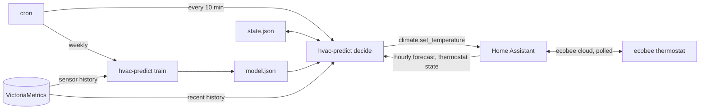

# hvac-predict architecture

> **Summary:** `hvac-predict` is a command line tool that chooses the heating and cooling setpoints of a Home Assistant thermostat left in auto mode. It predicts the house with a small thermal model fitted to VictoriaMetrics history. It has only run against simulations so far.

## Purpose

A thermostat cannot see the weather coming. Left alone, it runs the air conditioner at bedtime on a night that would have cooled the house anyway, or lets the house sit three degrees off target all evening because the wrong setpoint was the near one.

The tool is for one house and one owner. It decides, every ten minutes, which of two pairs of setpoints the thermostat should hold for the comfort setting its schedule has reached. Both setpoints of either pair stay live, so the thermostat keeps the house within a few degrees of the target whether or not the tool is running.

The owner wants comfort without having to think about it, ahead of saving energy. Until now that has meant keeping a summer set and a winter set of comfort settings on the thermostat and swapping them by hand. Two things the owner already relies on have to keep working: a vacation set on the thermostat keeps its own setpoints, and a schedule that steps up through a Morning setting keeps the furnace from climbing far in one run.

The operator's view of the tool is in the [README](../../README.md).

## Context

The diagram shows what the tool reads and writes on each scheduled run.



The tool talks to two services and keeps two files. VictoriaMetrics holds the sensor history, which reaches it from Home Assistant's Prometheus integration. Home Assistant supplies the hourly weather forecast and the thermostat's state, and passes the chosen setpoints on to the thermostat. `model.json` is the fitted model, and `state.json` is what the last run saw.

The tool never talks to the thermostat itself. Home Assistant's ecobee integration reaches it through ecobee's cloud service, which it polls at most every three minutes. Nothing calls the tool but a scheduler: it runs once and exits.

## Building blocks

All of the code is in `src/hvac_predict/`. The tests are in `tests/`, one `test_<module>.py` for most modules. `advisor.py` has two, `test_advise.py` and `test_steer.py`, one for each of its functions. `errors.py`, `grid.py`, `history.py` and `limits.py` are tested through the modules that use them.

| Module | Owns |
| --- | --- |
| `cli.py` | The two commands, their reports, and the exit status. The only place that reads the environment. |
| `config.py` | Loading and validating `hvac-predict.toml`. |
| `thermal.py` | The thermal model: fitting it, running it forward, and replaying history to measure it. No I/O. |
| `training.py` | `train`: splitting the history, choosing the lag time, judging the model, and reading and writing `model.json`. |
| `decision.py` | The rules that choose a pair from a prediction, including the time a house is given to reach a new target, the limit on how far a setpoint can go, and the hold. Also the two things the rules remember between runs, a change of target and the tool's last choice. No I/O. |
| `thermostat.py` | Reading the thermostat, deciding whether it is the tool's to steer, including whose hold it is on, and sending setpoints. Everything the code assumes about an ecobee is here, apart from the default name of the comfort attribute in `config.py`, and so is the conversion between Home Assistant's temperature unit and the history's. |
| `outlook.py` | The prediction of the house left alone: how much history it starts from, how old a reading may be, and how far ahead it reaches. |
| `advisor.py` | `decide`: one run from start to finish in `steer`, and in `advise` the steps that change nothing. It checks the thermostat's reading against the history, and leaves the prediction to `outlook.py` and the choice to `decision.py`. |
| `state.py` | What one run leaves for the next in `state.json`: the target and when it changed, the preference the tool set, and the pairs it has on record as sent. Also noticing a changed target, and when a house has reached it. |
| `history.py` | Loading the configured series from VictoriaMetrics onto a time grid. |
| `forecast.py` | Turning Home Assistant's hourly forecast into the model's drivers. |
| `solar.py` | The sun's position, clear-sky sunlight, and calibrating a light sensor against it. |
| `limits.py`, `units.py`, `grid.py` | Believable ranges for readings, unit conversion, and the time grid. |
| `victoriametrics.py`, `homeassistant.py`, `http.py` | The two service clients and the JSON-over-HTTP layer they share, which turns every failure into a one-line error. |
| `files.py`, `errors.py` | Atomic file writes, the lock that keeps two runs apart, and the errors an operator can fix. |

Four test helpers matter to anyone changing behaviour. `tests/fakes.py` stands in for both services; its `thermostat_attributes` is the one place the tests spell out what an ecobee is taken to report, and the stand-ins in `tests/test_cli.py` and `tests/closed_loop.py` build on it. `tests/house.py` simulates a house whose physics are known, written without the package's model code so that it can check it. `tests/advising.py` holds the leaky house and the steady readings that the tests of `advise`, `steer` and the outlook share. `tests/closed_loop.py` runs `steer` against the simulated house and a simulated auto-mode thermostat for days, and can be run by hand.

## How a decision is made

Each `decide` run goes through the same steps, in `advisor.steer`.

1. Take the lock beside `state.json`, so that only one run is under way, and read the file and the thermostat. Stop and say so if the enable switch is not on, the thermostat is not in `heat_cool` mode, it is holding a preset that is neither a hold on the setpoints alone nor the scheduled comfort setting, or its comfort setting has no configured target. Nothing is written.
2. If the thermostat is on a hold of its setpoints and they are not a pair `state.json` has on record as sent, the hold is somebody else's: stop and say so. Nothing is written.
3. Load the model, the recent history and the hourly forecast. Refuse to go on if the model was trained with other settings, if a reading is stale, or if the history and the thermostat disagree about the indoor temperature. Nothing is written.
4. Predict the indoor temperature with the equipment off, as far ahead as `decision.horizon_hours`.
5. Work out, from the state and the history, whether the house is still on its way to a target that has changed.
6. Choose a pair. A house on its way gets the settling rule and nothing else. Otherwise the overshoot rule decides if the house will leave the range the pairs cover. Failing that the resting rule decides, except that it does not reverse a preference the tool set less than `decision.min_hold_minutes` ago while the thermostat still holds it.
7. Write `state.json`, with the pair about to be sent on record as the tool's own. Then, with `--apply`, send the pair if the thermostat does not already hold it, and record the preference if it changed.

The rules themselves are stated in the module docstring of `decision.py` and decided in the records below.

## What the code assumes about Home Assistant

None of this has been checked against a real Home Assistant or an ecobee. It was read from the source of Home Assistant's `ecobee`, `prometheus` and `api` components.

| What the tool reads or calls | What it expects |
| --- | --- |
| State of `homeassistant.climate_entity` | `heat_cool` while the thermostat is in auto mode. |
| Its `climate_mode` attribute, or the one named by `homeassistant.comfort_attribute` | The name of the comfort setting the schedule has reached, such as `Home`, whether or not a hold is in force. |
| Its `preset_mode` attribute | `temp` while a hold on the setpoints alone is in force. With no hold, the scheduled comfort setting, which the integration puts in lower case for Home, Away and Sleep. Anything else is a hold the tool leaves alone. A thermostat that reports no `preset_mode` is steered. |
| Its `target_temp_low` and `target_temp_high` attributes | The heating and cooling setpoints, as numbers in Home Assistant's unit. While a hold the tool placed is in force, the pair it sent, to within 0.2 degrees in that unit. |
| Its `current_temperature` attribute | The thermostat's own reading, as a number in Home Assistant's unit. |
| `GET /api/config`, `unit_system.temperature` | `°C` or `°F`. |
| State of `homeassistant.enable_entity`, when set | `on` while the tool may steer. |
| Attributes of `homeassistant.weather_entity` | `temperature_unit`, `wind_speed_unit` and `precipitation_unit`. |
| `POST /api/services/weather/get_forecasts?return_response`, type `hourly` | A list of entries with `datetime` and `temperature`, and where the provider has them `wind_speed`, `precipitation`, `cloud_coverage` and `condition`. Needs Home Assistant 2024.8. |
| `POST /api/services/climate/set_temperature` with `target_temp_low` and `target_temp_high` | Places a hold on both setpoints and leaves the mode alone. How long the hold lasts is the thermostat's own setting. |
| The example `[history]` queries | Metric names as Home Assistant's Prometheus integration builds them, with temperatures in Celsius. |

## Decisions that shape this design

- [Steer setpoint pairs with the thermostat in auto mode](../adrs/2026-11-15-steer-setpoint-pairs-in-auto-mode.md). Accepted. The tool changes setpoints and never the mode. Its lines about the wider pair of a drift and the limit on it were added while implementing, and await the owner with question 15.
- [Give the house a fixed time to reach a new target unaided](../adrs/2026-11-15-give-a-new-target-time-to-be-reached-unaided.md). Accepted. The owner's rule for choosing a pair after a target changes. Its constraint that the house be at a new target "on time" is not met as written: in simulation a new target took up to four hours. Its "at it" is read as within a tenth of the differential, which awaits the owner with the completions record.
- [Complete the rules where the owner's are silent](../adrs/2026-11-15-complete-the-rules-where-the-owners-are-silent.md). Proposed. Five cases the owner's rule does not cover, with the answers the code currently gives.
- [Keep what the last run saw in a state file](../adrs/2026-11-15-keep-what-the-last-run-saw-in-a-state-file.md). Proposed. Where the time of a target change comes from.
- [Leave a hold the tool did not place alone](../adrs/2026-11-16-leave-a-hold-the-tool-did-not-place-alone.md). Proposed. How a vacation and a hold placed by hand are protected.
- [Predict with a fitted linear model that remembers stored heat](../adrs/2026-11-15-predict-with-a-model-that-remembers-stored-heat.md). Proposed. The form of the model, and what `train` must check before writing one.

The requirements these decisions put on the code are in [quality-attributes.md](quality-attributes.md).

## Open questions

Nothing below is settled. The first group can only be answered with a real Home Assistant, and should be answered before the first `--apply`.

### To check against the real system first

Checks 2 and 3 change the real thermostat: check 2 through a service call, check 3 by the owner starting a vacation. Do neither without the owner's go-ahead. Check 10 cannot be answered by reading either: it rides on check 2 or on the first `--apply`. Every other check only reads.

1. **Does the thermostat report what the code reads?** With the thermostat in auto mode and no hold, read its state and compare it with the table above: `climate_mode` names the scheduled comfort setting, `preset_mode` is that name, `target_temp_low` and `target_temp_high` are numbers, and so is `current_temperature`, without which `decide` refuses to run.

   ```sh
   curl -s -H "Authorization: Bearer $HASS_TOKEN" \
     'http://homeassistant.home.arpa:8123/api/states/climate.thermostat'
   ```

2. **What does `climate.set_temperature` do on this ecobee?** This check changes the real thermostat. Do it only with the owner's go-ahead, while they can watch, and write down the setpoints and `preset_mode` first. Call the service with `target_temp_low` and `target_temp_high` set to the pair the thermostat already holds, so that nothing starts or stops. Then read the state again and confirm that `preset_mode` has become `temp` while `climate_mode` still names the scheduled setting, see how long the hold lasts, and see what the thermostat falls back to when it ends. The ecobee's hold action setting decides: two hours, four hours, until the next scheduled activity, or indefinite. Leave the hold in place if check 3 follows at once; otherwise cancel it with the `ecobee.resume_program` service. A hold that ends at the next schedule change is the convenient case: the thermostat returns to its own setpoints for up to ten minutes, then the tool sets a pair for the new target. A two- or four-hour hold lapses inside a comfort setting, and the thermostat is on its own setpoints until the next run sends the pair again. An indefinite hold keeps the old pair until the tool replaces it.
3. **What does the thermostat report during a vacation that starts under a hold?** The owner needs a vacation's setpoints left alone. The integration reports the first running event in the thermostat's list, and nobody has checked whether an ecobee lists a running vacation ahead of a hold on the setpoints. Ask the owner to start a short vacation in the ecobee app while the hold from check 2 is in place, with the setpoints written down in check 2 moved by a degree so that the two can be told apart and nothing starts or stops. Then read the state. `preset_mode` reading `vacation` is the good case. `temp` with the vacation's setpoints is covered too: the tool takes them for somebody else's hold, unless they happen to match a pair it has on record. `temp` with the hold's setpoints means the thermostat keeps to a hold in spite of a vacation, and the tool cannot tell; switching the enable entity off and cancelling the tool's hold before a vacation then becomes a rule. Afterwards the owner deletes the vacation in the app, the test hold is cancelled with `ecobee.resume_program`, and one more read confirms `preset_mode` is back to the scheduled setting.
4. **Does the ecobee accept every pair the tool can send?** `comfort.differential` has to be at least its minimum gap between the setpoints, "Heat/Cool Min Delta", and each setpoint has to be inside the range the thermostat allows for it. The widest the tool can ask for is a heating setpoint twice the differential plus one degree below the lowest target, and a cooling setpoint as far above the highest: 58 and 74 °F for the example configuration, a degree inside the limit of 57 and 75. The owner's own comfort settings already hold a 64 °F cooling setpoint and a 3 °F gap, so the cool-preference pairs for the owner's targets are known to be accepted as comfort settings. The heat-preference pairs, and whether a hold has the same limits, are not. A pair the thermostat holds with a setpoint moved looks to the tool like somebody else's hold, and it stops steering; a pair it refuses outright is sent again on every run.
5. **Does the ecobee wait before starting its equipment?** The resting rule changes pair when the house crosses the target, and relies on the thermostat not starting anything for a fraction of a degree. Read the thermostat's heat and cool differential settings. They have to cover the drift over `min_hold_minutes`, not only the ten minutes between runs.
6. **Do the example queries return one series each?** The metric names in `config.example.toml` follow the source of the Prometheus integration. Run each one in VictoriaMetrics; the README shows how.
7. **How well does the model fit the real house?** Run `train` and one dry `decide`, and keep both reports as evidence receipts. The dry `decide` is also the only check of the unit Home Assistant reports, the weather entity's units and the hourly forecast. If the model does not beat "no change" comfortably, the first thing to try is in the [model record](../adrs/2026-11-15-predict-with-a-model-that-remembers-stored-heat.md).
8. **What does the thermostat report under Smart Home/Away or another event?** The integration reports `away` or `home` for the ecobee's automatic events, which the tool leaves alone unless that is also the scheduled setting. Other running events, such as a demand-response event, are not reported as a preset. The tool would steer through one. Only while its own hold is still reported, and the event has moved the setpoints away from the pair it sent, does it take them for somebody else's hold.
9. **How stale can the thermostat's state be?** The tool checks the age of VictoriaMetrics samples but not of the state it reads from Home Assistant, which can be three minutes behind the thermostat, or older if ecobee's cloud is unreachable. A hold or a vacation that starts inside that gap is not seen, and a run that changes pair then overrides it.
10. **Does the thermostat give back exactly what it was sent?** The tool knows its own hold by its setpoints, within 0.2 degrees in the unit Home Assistant shows, and it sends them to a tenth of a degree. A thermostat that rounds further than that, to half or whole degrees, would make the tool take its own hold for somebody else's. Answer it in check 2, by sending one setpoint a tenth of a degree off what the thermostat holds and reading it back, or from the run after the first `--apply`.

### About the rules

11. **How far from the target may a resting house sit?** The resting rule runs nothing while the house stays within the differential of the target, so on a mild day the house can sit 2 or 3 °F from where the owner asked. That follows the owner's own example, which switches preference only when the house would pass the differential. It sits badly with the owner's wish for comfort ahead of saving energy, and it is what lets a house start a Morning step from below the Sleep target. A smaller tolerance than the differential would hold the target more closely and switch between furnace and air conditioner more often. The owner has been asked and has not answered yet.
12. **How far ahead should a drift past the differential be acted on?** The default is eight hours, which holds the target early and runs the equipment more. It also acts at once on an overshoot that is hours away, so the equipment can start, bring the house in a little, and stop when the prediction no longer passes the edge. The [closed-loop receipt](../planning/evidence/2026-11-16-closed-loop-simulation.txt) shows the trade at 90 and 30 minutes. `decision.overshoot_minutes` is the setting. With comfort ahead of energy, the default looks right.
13. **Should a house that will arrive a little late still be driven?** With 90 minutes allowed, a house that would reach a lower target unaided in two hours is cooled by the air conditioner, and may need the furnace within the hour. That is the rule as the owner gave it, and it applies on a winter night as well: a house that holds its heat is cooled to the night-time target with the air conditioner, if the thermostat's own protections allow the compressor to run. A tolerance, a limit on outdoor temperature, or weighing what happens after arrival would change it.
14. **Should each comfort setting have one target, and one differential?** The owner's own comfort settings differ in two ways the configuration cannot express. The Sleep pair is 4 °F wide where the others are 3. And the Morning setting is a half-way step only when the furnace is doing the work; in summer it equals Home. One target per setting holds the house at the half-way step on a summer morning too. The [auto-mode record](../adrs/2026-11-15-steer-setpoint-pairs-in-auto-mode.md) lists two pairs per comfort setting as an alternative.
15. **Is the idle setpoint right during a drift?** The tool moves it clear of the house, so the setpoints are briefly further apart than the differential. The owner asked for two pairs and has not confirmed this third one. See the [proposed completions](../adrs/2026-11-15-complete-the-rules-where-the-owners-are-silent.md).
16. **Should a rising target wait for the weather too?** The owner's example is a target that drops, and the first request asked for the house to be left to "cool off or warm up on its own" alike. So a target that rises gets the same 90 minutes: on a Morning step the furnace waits while the model expects the house to warm by itself, and each step restarts the time. The owner's stepped warm-up suggests the furnace is expected to run on a cold morning, which it does. Whether it should also wait on a mild one has not been asked.
17. **Should a settling house be allowed to change between drifting and driving?** A drift becomes a drive when the prediction slips, and a drive becomes a drift once the equipment has brought the house close enough to arrive unaided in the time left. Nothing limits how often, because the hold does not apply while a house settles.
18. **Should the tool know the schedule?** It learns of a new target only when the comfort setting changes. It cannot begin early, and it judges a drift against the current target even when a change is minutes away.

### About operation

19. **What should the thermostat's own comfort settings and hold action be?** The README recommends holds that end at the next scheduled activity, and says what the comfort settings' own setpoints do in the minutes before the tool's next run. Heating at the target minus the differential and cooling at the target plus it covers only a step no bigger than the differential. All of it is reasoned from the integration's source and untried.
20. **Should the tool release its hold when it stops steering?** When it leaves the thermostat alone, because of the enable switch or a comfort setting with no target, its last pair stays for as long as the thermostat's hold action says. With an indefinite hold that is until someone cancels it. The `ecobee.resume_program` service would hand the thermostat back at once.
21. **Who should hear that the tool has stopped steering?** A hold placed by hand, a pair the thermostat changed before holding it, and a lost state file all leave the tool waiting for the hold to end, with exit status 0. With an indefinite hold that is until someone cancels it. Only the `left_alone` value in the log says so.
22. **Should the state come from Home Assistant's history instead of a file?** See the [state file record](../adrs/2026-11-15-keep-what-the-last-run-saw-in-a-state-file.md).
23. **What catches a frozen sensor, or an old model?** The history's indoor temperature is checked against the thermostat's own reading. With the example query both are the same Home Assistant attribute, so the check catches a wrong query or unit and not a frozen thermostat. The climate entity's `last_updated` could be checked instead. Nothing checks the outdoor sensor, and `decide` does not look at the model's age.
24. **Should a paused run keep the clock?** A run that leaves the thermostat alone writes nothing, so after a pause of more than 30 minutes a change of target is taken to be as old as the pause.
25. **Should a reading's age be counted from the run?** HVP-008 gives a reading 20 minutes. The code counts them back from the newest five-minute mark, which can be almost five minutes before the run, so a reading nearly 25 minutes old is still acted on.
26. **Should the model file be checked as closely as the state file?** `load_model` checks the format number, the names of the weights, and that the settings the model depends on are unchanged. It believes the rest. A `step_seconds` edited by hand stretches the 20 minutes of HVP-008 with it, and a zero there ends in a traceback.
